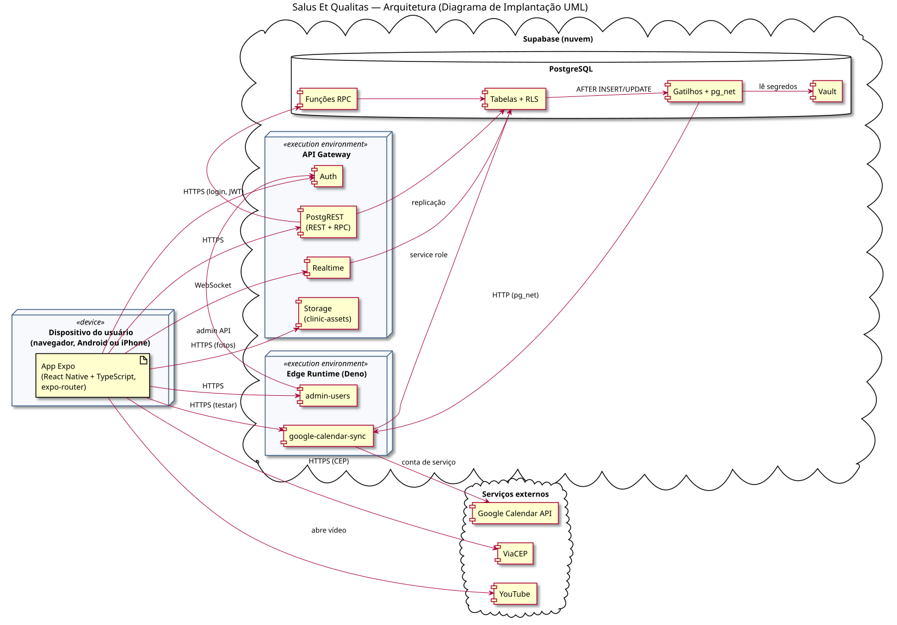
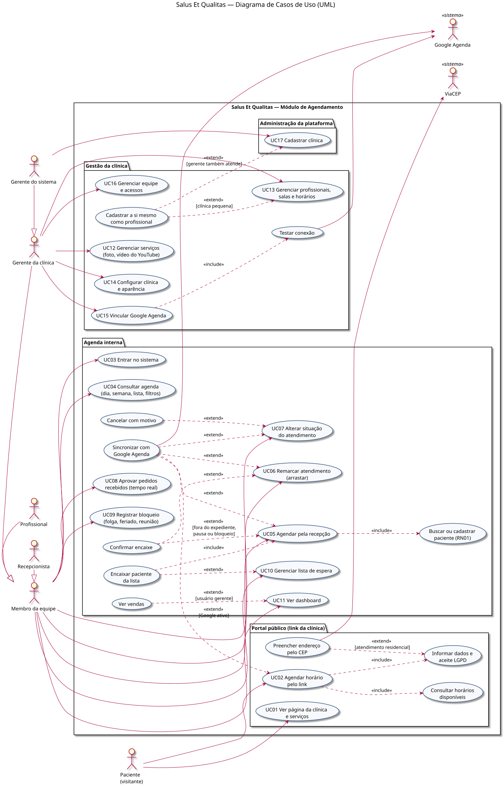
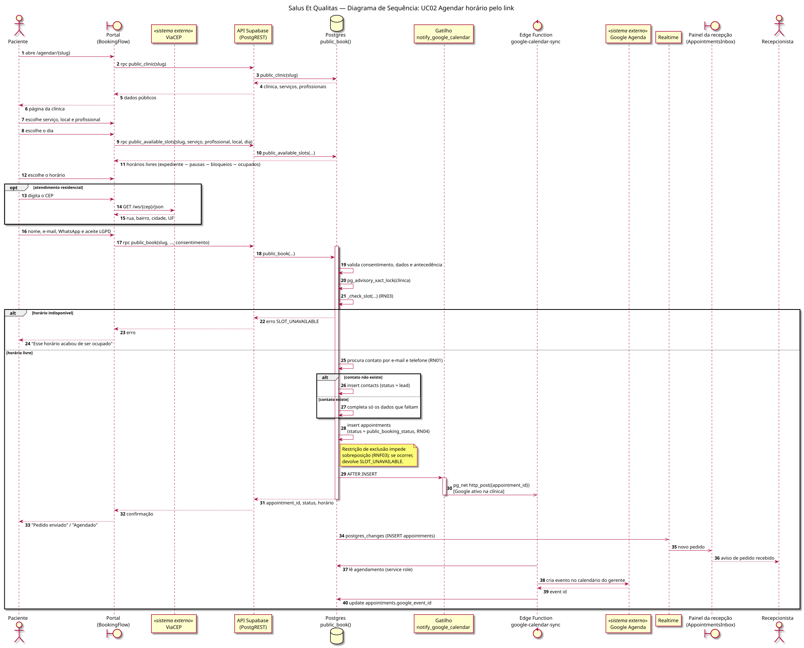
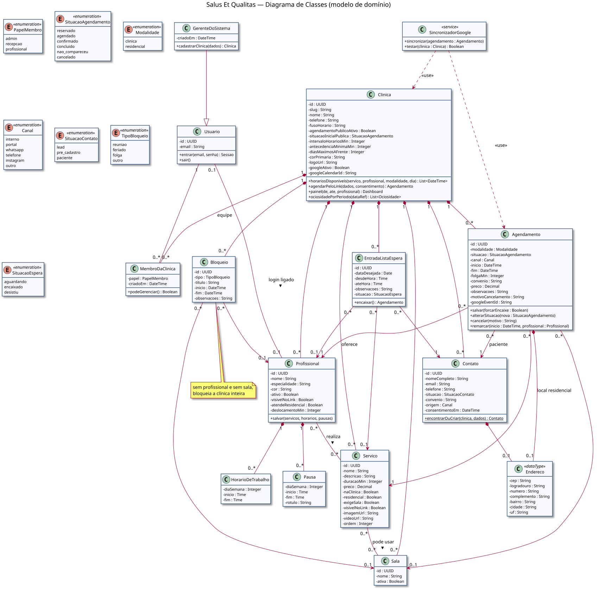
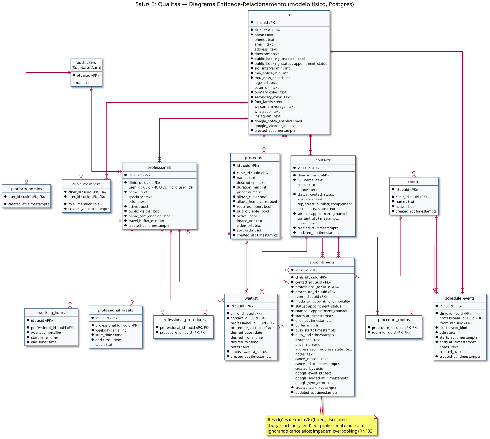

# Salus Et Qualitas — Arquitetura e modelagem UML

Os fontes dos diagramas estão em [`docs/uml/`](uml/), em PlantUML (`.puml`). Cada um também foi exportado em `.svg` e `.png`.
Para gerar de novo: `cd docs/uml && plantuml -tsvg -charset UTF-8 *.puml`.

## 1. Arquitetura

O sistema é **cliente–servidor em nuvem, no modelo BaaS (Backend as a Service)**. Um único app atende computador, Android e iPhone, e o backend gerenciado é o Supabase.

O sistema tem três camadas.

### Apresentação (cliente)

É um app **Expo**: React Native com TypeScript e expo-router. O mesmo código roda no navegador (React Native Web), no Android e no iOS.

O código é organizado por funcionalidade:
- `features/booking`: portal público do paciente;
- `features/agenda`: agenda interna;
- `features/panel`: cadastros e configurações;
- `features/dashboard`: indicadores.

Em `lib/` ficam funções utilitárias:
- `tz.ts`: fuso horário da clínica;
- `format.ts`: máscaras;
- `schedule.ts`: horários;
- `supabase.ts`: cliente da API.

### Serviços (Supabase)

- **Auth:** login por e-mail e senha. Emite um JWT que o banco usa para identificar o usuário.
- **PostgREST:** API REST gerada a partir do banco. Também expõe as funções SQL como RPC.
- **Realtime:** notifica o painel na hora em que chega um agendamento novo (RNF03, RF05).
- **Storage:** guarda logos, capas e fotos de serviços (bucket `clinic-assets`).
- **Edge Functions (Deno):**
  - `admin-users` cria e gerencia os logins da equipe, usando a API administrativa do Auth;
  - `google-calendar-sync` envia os agendamentos para o Google Agenda do gerente.

### Dados e regras de negócio (PostgreSQL)

As regras críticas ficam **dentro do banco**. Assim valem igualmente para web, Android, iPhone e qualquer integração futura.

- **Row Level Security (RLS):** cada linha pertence a uma clínica. Um usuário só vê as clínicas das quais é membro (multi-inquilino). O usuário anônimo não lê nenhuma tabela (RNF05/LGPD).
- **Funções `security definer`:**
  - `public_clinic`, `public_available_slots` e `public_book` atendem o portal;
  - `staff_save_appointment` e `staff_upsert_contact` atendem a recepção;
  - `save_professional` atende o cadastro de profissionais;
  - `clinic_dashboard` e `clinic_idle_overview` atendem o dashboard.
- **Restrições de exclusão (`btree_gist`):** impedem dois atendimentos sobrepostos para o mesmo profissional ou a mesma sala, mesmo com pedidos simultâneos (RN03/RNF03).
- **Gatilhos:**
  - `appointments_before_write` calcula a folga de deslocamento;
  - `professionals_guard` e `clinics_guard` validam os dados;
  - `notify_google_calendar` chama a Edge Function via `pg_net`, com os segredos guardados no **Vault**.

### Integrações externas

- **Google Calendar API:** usa uma conta de serviço.
- **ViaCEP:** preenche o endereço a partir do CEP.
- **YouTube:** vídeos dos serviços.

### Padrões usados

| Padrão | Onde |
|---|---|
| Cliente–servidor / BaaS | App Expo + Supabase |
| Arquitetura em camadas | apresentação → API → banco com regras |
| Multi-inquilino (*multi-tenant*) por linha | `clinic_id` em todas as tabelas + RLS |
| Organização por funcionalidade (*feature folders*) | `app/src/features/*` |
| Procedimentos armazenados como camada de serviço | funções RPC no Postgres |
| Orientado a eventos | gatilho → `pg_net` → Edge Function; Realtime → painel |
| Controle de acesso por papéis (RBAC) | `member_role`: admin, recepcao, profissional + gerente do sistema |

## 2. Atores

| Ator | Descrição |
|---|---|
| Paciente (visitante) | Agenda pelo link público, sem login. |
| Membro da equipe | Ator abstrato: qualquer usuário com login na clínica. |
| Recepcionista | Membro com papel `recepcao`. |
| Profissional | Membro com papel `profissional`. |
| Gerente da clínica | Membro com papel `admin`. Herda tudo do membro e gerencia a clínica. |
| Gerente do sistema | Administra a plataforma. Herda do gerente da clínica e acessa todas as clínicas. |
| Google Agenda | Sistema externo que recebe os agendamentos. |
| ViaCEP | Sistema externo que devolve o endereço de um CEP. |

## 3. Casos de uso

| ID | Caso de uso | Ator principal | Requisitos |
|---|---|---|---|
| UC01 | Ver página da clínica e serviços | Paciente | RF08 |
| UC02 | Agendar horário pelo link (inclui consultar horários e informar dados com aceite LGPD; estende com preencher endereço pelo CEP) | Paciente | RF08–RF12, RN01, RN03, RN04, RNF05 |
| UC03 | Entrar no sistema | Membro da equipe | — |
| UC04 | Consultar agenda (dia, semana, lista e filtros) | Membro da equipe | RF01–RF04 |
| UC05 | Agendar pela recepção (inclui buscar ou cadastrar paciente; estende com confirmar encaixe) | Membro da equipe | RF02, RN01, RN03 |
| UC06 | Remarcar atendimento (arrastar) | Membro da equipe | RNF04 |
| UC07 | Alterar situação do atendimento (estende com cancelar com motivo) | Membro da equipe | RF05 |
| UC08 | Aprovar pedidos recebidos em tempo real | Membro da equipe | RF05, RN04, RNF03 |
| UC09 | Registrar bloqueio (folga, feriado, reunião) | Membro da equipe | RF07 |
| UC10 | Gerenciar lista de espera (estende com encaixar paciente da lista) | Membro da equipe | RF06 |
| UC11 | Ver dashboard (estende com ver vendas, só para o gerente) | Membro da equipe | RF14 |
| UC12 | Gerenciar serviços (foto, vídeo do YouTube, visibilidade) | Gerente da clínica | — |
| UC13 | Gerenciar profissionais, salas e horários (estende com cadastrar a si mesmo como profissional) | Gerente da clínica | RF13 |
| UC14 | Configurar clínica e aparência | Gerente da clínica | — |
| UC15 | Vincular Google Agenda (inclui testar conexão) | Gerente da clínica | — |
| UC16 | Gerenciar equipe e acessos | Gerente da clínica | — |
| UC17 | Cadastrar clínica | Gerente do sistema | — |
| — | Sincronizar com Google Agenda: estende UC02, UC05, UC06 e UC07 quando a clínica tem o Google ativo | Google Agenda | — |

## 4. Diagrama de sequência — UC02 Agendar horário pelo link

Este é o fluxo principal do sistema. Ele mostra:
- a consulta de horários;
- a reserva com trava e a checagem de conflito;
- o *match* de contato (RN01);
- o aviso em tempo real para a recepção;
- a sincronização assíncrona com o Google Agenda.

## 5. Diagrama de classes (modelo de domínio)

Os nomes estão em português para leitura. Cada classe corresponde a uma tabela:

| Classe | Tabela |
|---|---|
| Clinica | `clinics` |
| Profissional | `professionals` |
| Servico | `procedures` |
| Sala | `rooms` |
| Contato | `contacts` |
| Agendamento | `appointments` |
| Bloqueio | `schedule_events` |
| EntradaListaEspera | `waitlist` |
| MembroDaClinica | `clinic_members` |
| HorarioDeTrabalho | `working_hours` |
| Pausa | `professional_breaks` |

Os métodos representam as operações expostas pelas funções RPC e pelas telas.

## 6. Diagrama entidade-relacionamento

Este é o modelo físico no PostgreSQL, em notação pé-de-galinha:
- `||` significa exatamente um;
- `o|` significa zero ou um;
- `o{` significa zero ou muitos.

Os campos marcados com `*` são obrigatórios (`NOT NULL`).

A UML não define um "diagrama ER" próprio. Por isso o modelo conceitual está no diagrama de classes, e este diagrama documenta as tabelas, as chaves primárias e estrangeiras e as cardinalidades reais do banco.

